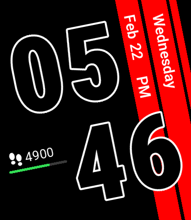
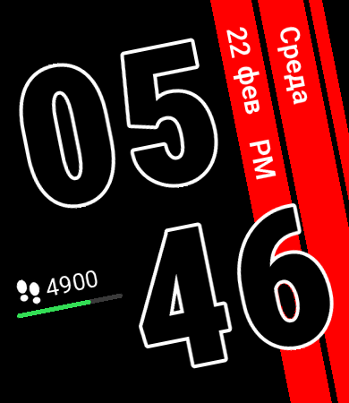
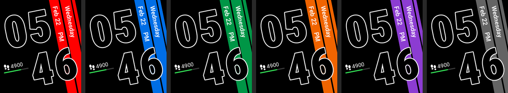

# zepp-watchface-red-stripes

A Zepp OS watch face for 390×450 Amazfit watches: big outlined digits, diagonal
stripes carrying the weekday and date, and a step counter with a thin battery
line. Everything except the stripes is tilted to sit perpendicular to them.

 

## Features

- Hours over minutes in large outlined digits; follows the watch's 12/24-hour setting (AM/PM shown in 12-hour mode)
- Weekday and date on the stripes, in English or Russian depending on the watch language
  (English "Feb 22", Russian "22 фев"; other languages fall back to English)
- Step count with a battery line under it, red below 20 %
- Stripe color picked on the watch: long-press the face → Edit → tap to cycle through 6 colors
- Always-on display: time, weekday and date, white on black



## Supported devices

| Device | API level |
|---|---|
| Amazfit Bip 6 | 4.2 |
| Amazfit Active 2 (Square) | 4.2 |
| Amazfit Active | 3.6 |
| Amazfit Cheetah (Square) | 3.7 |
| Amazfit GTS 4 | 3.5 |

All share the 390×450 screen; they are platforms of one target in `app.json`.
The face needs API level 2.1, so 390×450 devices on Zepp OS 1.0 (GTS 3) are not supported.

## Development

Requires [Zeus CLI](https://docs.zepp.com/docs/guides/tools/cli/) and Node.js.

```sh
zeus dev                               # run in the Zepp OS Simulator
zeus preview                           # QR code to install on a watch (Zepp app → Developer Mode)
zeus build -t 390x450-amazfit-bip-6    # package for the store, written to dist/
node --test test/                      # unit tests
```

### Images and layout

Zepp OS TEXT widgets can't be rotated, so every tilted element is a pre-rendered
image. `tools/gen_assets.py` draws them all and writes `watchface/layout.js` with
their sizes and positions. Edit the constants at the top of the script (geometry,
stripe colors, label text per language) and regenerate:

```sh
pip install pillow
python3 tools/gen_assets.py
```

The script also renders the previews (`assets/…/icon.png` for the watch and
`tools/preview-*.png`) through the same scene logic the watch face uses.

### Project layout

| Path | What it is |
|---|---|
| `watchface/index.js` | Watch face: creates image widgets once, refreshes on minute, battery and step changes |
| `watchface/scene.js` | Pure logic: which image goes where for a given time, date, language, battery and steps |
| `watchface/layout.js` | Generated geometry (do not edit by hand) |
| `utils/format.js` | Clock digits and battery line helpers |
| `tools/gen_assets.py` | Image and layout generator |
| `tools/preview_scene.mjs` | Prints a sample scene for the preview renderer |
| `assets/390x450-amazfit-bip-6/` | Generated images |
| `test/` | Node tests for the scene and helpers |

## Font

Digits and labels are rendered with [Roboto](https://github.com/googlefonts/roboto-classic),
licensed under the SIL Open Font License 1.1 (`tools/fonts/OFL.txt`).
